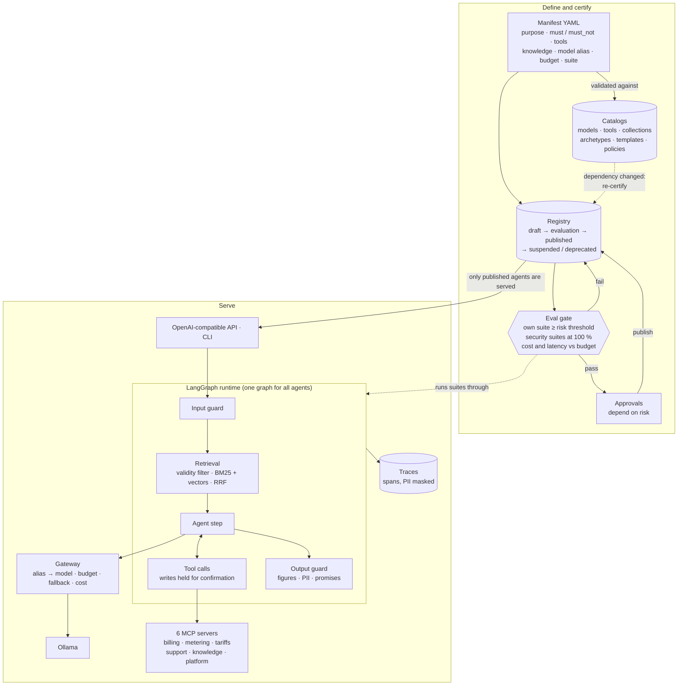

# Charter

A prototype platform where LLM agents are declared as versioned YAML manifests, and each one must pass an evaluation gate before it can be published.

Once several teams in a company start building their own agents, nobody can answer basic questions: how many agents exist, which model each one runs on, what customer data it touches, and what it costs. The approach here is to make the agent a piece of configuration instead of code. A manifest declares purpose, constraints, tools, knowledge collections, a model *alias*, a budget and an eval suite. The platform validates it against curated catalogs, computes its risk level, runs it through a single runtime and gateway, and only serves it after the gate and the approvals required for that risk level. The applied case is an energy retailer: billing, smart-meter readings, tariffs and customer support.

Everything runs locally on Ollama (Qwen 2.5 3B/7B, Qwen3 8B, `nomic-embed-text`). No API keys. All customer, invoice, meter and tariff data is synthetic, generated by [`scripts/generar_datos.py`](scripts/generar_datos.py) with a fixed seed.

> The code, CLI and docs are in Spanish. Identifiers map closely to the concepts below (`manifiesto` = manifest, `compuerta` = gate, `registro` = registry).

## What's interesting here

- **Six MCP servers, one per backing system.** Billing, metering, tariffs, support (the only write tool), knowledge search and platform introspection ([`mcp_servers/`](mcp_servers/)). Each server is connected once and becomes available to any agent whose manifest declares it. Servers don't know which agent is calling; permission checks happen in the runtime before each call. Transport is stdio.
- **Agents as versioned YAML manifests, spec-driven.** A manifest ([example](manifiestos/sac-asistente-facturacion.yaml)) states intent (`purpose`), constraints (`must` / `must_not`, data classification, autonomy level), and acceptance criteria (`quality.suite`, `min_pass_rate`) before anything runs. No manifest names a concrete model, only an alias (`rapido`, `estandar`, `razonamiento`) resolved by [`catalogos/modelos.yaml`](catalogos/modelos.yaml). Risk is computed by the platform, not declared by the author.
- **Evaluation gate in front of publishing.** [`plataforma/evaluacion.py`](plataforma/evaluacion.py) runs three layers: the agent's own suite against a threshold set by its risk (85 / 90 / 95 %), shared security suites (direct and indirect prompt injection, cross-customer PII) that must pass at 100 %, and cost/latency against the manifest's budget. The registry refuses to publish without a passing gate plus risk-dependent approvals. Each published agent stores a fingerprint of what it depends on (model behind its alias, tools, collections, prompt template, inherited policies), and any change to those sends it back to evaluation.
- **85 automated tests that run without a model.** The gateway gets a scripted fake model; manifests, catalogs, registry, MCP servers, guards and traces are real. `pytest` takes under 20 s and needs no Ollama. Model quality is measured by the gate, not by unit tests.
- **Guards, traces and an OpenAI-compatible API.** The input guard blocks injection and requests for another customer's data without calling the model. The output guard checks every number in the answer against tool results from the same conversation, and blocks promises (discounts, payment agreements), other customers' PII and claims of writes that didn't happen. Writes are held until the user confirms. Every step is a span with agent, version, model, tokens, cost and latency, with PII masked before storage. [`plataforma/api.py`](plataforma/api.py) exposes each published agent as a "model" on `/v1/chat/completions`; the bearer token defines the session, so customer identity never comes from the request body.
- **An "Architect" agent that creates other agents.** [`plataforma/arquitecto.py`](plataforma/arquitecto.py) answers questions about the platform (RAG over its docs plus live registry data) and runs a five-question interview to create a new agent. The model only extracts JSON from each answer. Code picks the archetype, model tier, risk, threshold and approvals, takes the owner from the session, and turns the user's examples into the new agent's first eval suite. The Architect is itself a manifest: it runs through the same runtime and gateway and has its own gate.

## Architecture



## Design decisions

These come from [docs/DECISIONES.md](docs/DECISIONES.md) §4, where each one is documented with the data behind it.

**1. Numbers come from tools, and the output guard verifies them.**
To explain why an invoice went up, the agent needs percentages (how much is consumption vs. tariff). The `calcular_desglose` tool returns them precomputed, and the output guard requires every figure in the answer to appear in a tool result from the same conversation. Visibly rounded figures ("5,37 millones") get 0.5 % tolerance; full amounts must match exactly. Together with the runtime fixes in §4.4 and the write confirmation in §4.6, this took the billing agent's suite from 80 % to 100 %.
*Trade-off:* the guard compares values, not units. A correct number with the wrong unit (pesos vs. kWh) would pass. Listed as a next step.

**2. Scope check in two steps, cheapest first.**
The input guard first does a free lexical check: if the message shares vocabulary with the agent's purpose, tools and collections, it passes. Only messages with no overlap go to an LLM classifier on the `rapido` tier. On 18 test messages, the classifier alone got 13 right (with both 3B and 7B); the two-step version got 17.
*Trade-off:* the design lets borderline messages through rather than block a customer. The agent stays bounded by its tool list and the inherited "outside my purpose" policy.

**3. The tier tree proposes a model; the gate confirms it.**
The internal-procedures agent started on `rapido` (3B). Letting the model decide whether to search scored 71 % on its suite. Making retrieval mandatory in the runtime for document-QA archetypes raised it to 100 %, but it passed only 3 of 4 security cases. Moving to `estandar` (7B) passed 4/4: the 7B model resisted an indirect injection planted in a forum document on its own.
*Trade-off:* 3.6× the cost per conversation (US$0.00055 vs. US$0.00015 reference cost) for two lines of defense instead of one. Going back to `rapido` is a one-line change plus a gate run.

**4. Agent creation is a guided flow, not a free agent.**
A router in code separates questions about the platform (answered by the RAG agent) from the intent to create an agent (handled by a fixed five-step flow). The handoff between the two is a typed object, not the chat history. Compared with an earlier Architect that ran the interview as a free tool-using agent, the guided flow completed the interview and registered the draft with the right owner and suite, with 1–9 s turns. The free agent needed many more calls and did not register consistently.
*Trade-off:* less flexibility. The user can ask side questions mid-interview, but can't yet go back and edit an earlier answer without restarting.

The local-prototype vs. production mapping is in [§2 of the same doc](docs/DECISIONES.md#2-prototipo-y-producción): `gateway.py` instead of LiteLLM, SQLite and a JSON index instead of PostgreSQL + pgvector, a `spans` table instead of Langfuse/OpenTelemetry, a sessions file instead of SSO, MCP over stdio instead of HTTP.

## Repository layout

```text
catalogos/      Curated by the AI team: models (aliases), tools, collections,
                archetypes, instruction templates and inherited policies
manifiestos/    The agents: one versioned YAML each (borradores/ holds those created with the Architect)
evals/          Gate suites: one per agent, plus shared security suites (comunes/)
conocimiento/   Documents behind the knowledge collections, each with owner and validity dates
datos/          Synthetic customers, invoices, meter readings and tariffs (scripts/generar_datos.py)
mcp_servers/    One MCP server per system: billing, metering, tariffs, support, knowledge, platform
plataforma/     The core: manifest, registry, gateway, runtime, guards, knowledge, gate,
                Architect, traces, API and the `charter` CLI
tests/          85 automated tests that run without Ollama
docs/           The proposal (PDF and LaTeX source), implementation decisions and demo guide
```

Each module in `plataforma/` opens with a comment explaining which part of the architecture it implements and why it is built that way.

## Quickstart

Requires Python 3.11+ (tested with 3.14 on macOS) and [Ollama](https://ollama.com).

**macOS / Linux**

```bash
python3 -m venv .venv && source .venv/bin/activate && pip install -e .
ollama serve        # in another terminal
ollama pull qwen2.5:7b-instruct qwen2.5:3b qwen3:8b nomic-embed-text

pytest                                              # 85 offline tests, no Ollama needed
charter iniciar                                     # register manifests, index knowledge
charter inventario                                  # agent, model and orchestration inventories
charter evaluar sac-procedimientos-internos         # run the gate (~1 min)
charter chat sac-asistente-facturacion --sandbox    # try the billing agent
charter arquitecto                                  # ask about the platform or create an agent
charter servir                                      # OpenAI-compatible API on :8000
```

**Windows (PowerShell)**

```powershell
py -m venv .venv; .venv\Scripts\Activate.ps1; $env:PYTHONUTF8 = "1"; pip install -e .
# Ollama for Windows runs in the background after install
ollama pull qwen2.5:7b-instruct qwen2.5:3b qwen3:8b nomic-embed-text
```

The `charter` commands are the same. If PowerShell won't activate the venv, run `Set-ExecutionPolicy -Scope Process RemoteSigned` first. Windows Terminal renders the CLI tables correctly.

Local state (registry, traces, index) lives in `.estado/` and is rebuilt by `charter iniciar`. Optional settings are in [`.env.example`](.env.example).

## Documents

| Document | What it covers |
|---|---|
| [docs/propuesta-arquitectura-agentes-v5.pdf](docs/propuesta-arquitectura-agentes-v5.pdf) | The original architecture proposal: what an agent is, how it's created without writing prompts, how it's evaluated, the billing case and the roadmap. LaTeX/TikZ source in [docs/propuesta-latex/](docs/propuesta-latex/). (Spanish) |
| [docs/DECISIONES.md](docs/DECISIONES.md) | Where each part of the proposal lives in code, what was simplified for the prototype, the decisions with their data, and gate results. (Spanish) |
| [docs/GUIA-DEMO.md](docs/GUIA-DEMO.md) | A ~20-minute command-by-command walkthrough: inventories, gate, publishing, the billing agent, the Architect and the API. (Spanish) |

## License

MIT. See [LICENSE](LICENSE).
